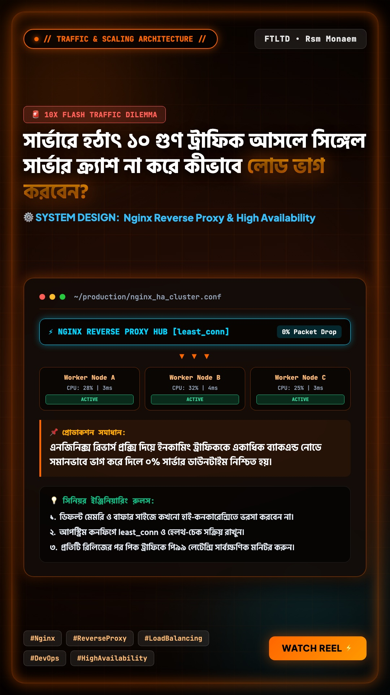

# 🚀 Hyper Video Studio

<div align="center">


**An autonomous, multi-aspect-ratio developer video & thumbnail creation suite.**  
*Produce 60fps seek-safe motion graphics, neural voiceovers, psychological dilemma hooks, and broadcast-grade thumbnails for YouTube, Reels, TikTok, and LinkedIn.*

[Features](#-key-features) • [Production Showcase](#-production-showcase--live-output-sample) • [Quickstart](#-quickstart) • [VPS Deployment](#-vps--cloud-deployment) • [Dashboard](#-command--control-dashboard) • [Architecture](#-architecture) • [Custom Skills](#-extensible-skills-system)

</div>

---

## 🎨 Production Showcase & Live Output Sample

> **Production Topic:** Nginx Reverse Proxy & High-Availability Load Balancing  
> **Viral Dilemma Hook:** *"সার্ভারে হঠাৎ ১০ গুণ ট্রাফিক আসলে সিঙ্গেল সার্ভার ক্র্যাশ না করে কীভাবে লোড ভাগ করবেন?"*  
> **Output Assets:** 1080×1920 60fps Motion Video, Studio Bengali Neural Voiceover, 1080×1920 (9:16) Developer Visual Card & Multi-Platform Copy.

<div align="center">

<table>
<tr>
<th width="50%" align="center">🎬 Rendered 9:16 Motion Video (Live Playable)</th>
<th width="50%" align="center">🖼️ Visual 9:16 Thumbnail (1080×1920)</th>
</tr>
<tr>
<td align="center" valign="middle">

<video src="examples/sample-output/2026-10-27_vertical_reel.mp4" controls="controls" width="100%" style="max-height: 600px; border-radius: 16px; box-shadow: 0 10px 35px rgba(0,0,0,0.75);">
  <a href="examples/sample-output/2026-10-27_vertical_reel.mp4">▶️ Watch Sample Video (MP4)</a>
</video>

</td>
<td align="center" valign="middle">

<a href="examples/sample-output/2026-10-27_dev_card_portrait.jpg" target="_blank">
  
</a>

</td>
</tr>
</table>

<p align="center">
  ⚡ <b>Duration:</b> 32.4s &nbsp;•&nbsp; 
  🎙️ <b>Voiceover Audio:</b> <a href="examples/sample-output/2026-10-27_vertical_reel_voice.mp3">Download / Listen Audio (MP3)</a> &nbsp;•&nbsp; 
  🎨 <b>Theme:</b> Fire Ember (1080×1920)
</p>

</div>

<details>
<summary><b>📝 View Generated Multi-Platform Copy (YouTube Shorts, LinkedIn, Facebook, Instagram)</b></summary>
<br>

```json
{
  "youtube": {
    "title": "সার্ভারে হঠাৎ ১০ গুণ ট্রাফিক আসলে সিঙ্গেল সার্ভার ক্র্যাশ না করে কীভাবে লোড ভাগ ... 🚀 #Shorts",
    "description": "Nginx Reverse Proxy & High-Availability Load Balancing - রিয়েল-লাইফ সফটওয়্যার ইঞ্জিনিয়ারিং ও সিস্টেম ডিজাইন টিপস...",
    "tags": ["Tech Bangla", "Software Engineering", "System Design", "DevOps", "Nginx", "Load Balancing"]
  },
  "linkedin": {
    "text": "Architecting for High Throughput: Nginx Reverse Proxy & High-Availability Load Balancing\n\nWhen scaling production services, bottlenecks rarely emerge from clean code logic itself. They almost always stem from resource contention..."
  },
  "facebook": {
    "text": "সার্ভারে হঠাৎ ১০ গুণ ট্রাফিক আসলে সিঙ্গেল সার্ভার ক্র্যাশ না করে কীভাবে লোড ভাগ করবেন? ⚡🛠️\n\nএনজিনিক্স রিভার্স প্রক্সি দিয়ে ইনকামিং ট্রাফিককে একাধিক ব্যাকএন্ড নোডে সমানভাবে ভাগ করে দিলে ০% সার্ভার ডাউনটাইম নিশ্চিত হয়..."
  }
}
```

</details>

---

## 🌟 Key Features

### 🎬 1. Deterministic Frame-by-Frame Motion Engine
- **Zero Jitter & Zero Frame Drops**: Driven by paused GSAP timelines (`masterTl.seek(t)`) rendered directly through headless Chromium into FFmpeg pipes.
- **Adaptive Multi-Aspect Ratio Matrix**:
  - `9:16` (1080×1920) : YouTube Shorts, Instagram Reels, TikTok
  - `16:9` (1920×1080) : Standard YouTube, TV, Desktop
  - `1:1` (1080×1080) : Square Feed (Instagram/Facebook)
  - `4:5` (1080×1350) : Portrait Social Feed
  - `4:3` (1440×1080) : Classic Presentations
  - `3:4` (1080×1440) : Tall Social Feed
- **Dynamic Aesthetic Themes**: *Cyber Cyan*, *Fire Ember*, *Matrix Terminal*, *Tokyo Midnight*, and *Studio Obsidian*.

### 🖼️ 2. High-CTR Broadcast Thumbnail Studio
- **100% Flawless Bengali & English Typography**: Integrates Google Fonts *Hind Siliguri* and *JetBrains Mono* to prevent broken ligatures.
- **Dual Aspect Export**: Generates **1920×1080 (YouTube)** and **1080×1920 (Reels cover)** thumbnails in 3 seconds.
- **Click-Inducing Aesthetics**: 3D glass cards, neon glow drop-shadows, kicker pills, and code snippet mockups.

### 🎙️ 3. Multi-Engine Neural Audio Studio
- **Native Edge-TTS (100% Free / Zero API Key)**: Studio-grade Bengali (`bn-IN-BashkarNeural`, `bn-BD-PradeepNeural`, `bn-BD-NabanitaNeural`) and English (`en-US-AndrewMultilingualNeural`).
- **ElevenLabs Multilingual v2**: Plug in your API key for custom studio voices.
- **OpenAI TTS**: Native support for `onyx`, `alloy`, and `nova`.
- **Procedural Audio FX**: Built-in royalty-free sound effects (*Whoosh*, *Pop*, *Click*, *Boom*, *Riser*) mixed with automatic audio ducking (`-22dB`).

### 🧠 4. Cost-Efficient & Model-Agnostic LLM Engine
- **Zero-Cost Curated Blueprints**: Generates high-retention engineering dilemmas without needing any paid AI API keys!
- **Google Gemini**: Gemini 2.5 / 3.0 Flash & Pro.
- **OpenAI**: GPT-4o / GPT-4o-mini.
- **OpenRouter & OmniRouter**: Claude 3.5 Sonnet, DeepSeek V3, Llama 3.3.
- **Local AI / Ollama**: Point `base_url` to `http://localhost:11434/v1`.
- **Custom Script & Batch Studio**: Manually craft custom scene scripts or batch-generate multiple videos at once!

### ⏰ 5. Zero-Terminal Cron & Automation Manager
- Manage daily automated runs directly from the web dashboard!
- **macOS**: Configures `~/Library/LaunchAgents/com.hypervideostudio.daily.plist`.
- **Linux / VPS**: Installs and monitors user `crontab` automatically.
- **One-Click**: Change schedule time (e.g. 10:30 AM), trigger immediate runs, or disable without touching a terminal.

---

## ⚡ Quickstart

### Prerequisites
- **Python 3.10+**
- **Node.js 18+**
- **FFmpeg** (`brew install ffmpeg` on macOS, `apt install ffmpeg` on Linux)
- **Google Chrome** or **Chromium**

### 1. Clone & Setup
```bash
git clone https://github.com/rsmmonaem/hyper-video-studio.git
cd hyper-video-studio
npm install
pip install -r requirements.txt
```

### 2. Launch the Dashboard
#### On macOS / Linux:
```bash
./start.sh
```
#### On Windows:
```cmd
start.bat
```

Open your browser at **[http://localhost:8585](http://localhost:8585)**!

---

## 🖥️ Command Line Interface (CLI)

You can also run everything headlessly from the terminal:

```bash
# 1. Run full autonomous video pipeline
./cli.py run-pipeline

# 2. Run with custom topic and 16:9 YouTube landscape format
./cli.py run-pipeline --topic "PostgreSQL Indexing" --hook "কোটি কোটি রো থাকা সত্ত্বেও ৩ms-এ কুয়েরি কেন?" --aspect 16:9

# 3. Start web dashboard server
./cli.py dashboard --port 8585

# 4. Check or install daily scheduler
./cli.py scheduler --status
./cli.py scheduler --install --hour 10 --minute 30
./cli.py scheduler --remove
```

---

## ☁️ VPS & Cloud Deployment

### Method A: Docker Compose (Recommended)
Deploy on any Ubuntu/Debian VPS with one command:

```bash
docker-compose up -d --build
```
The dashboard will be live at `http://your-vps-ip:8585`.

### Method B: Systemd Service (Linux)
Create `/etc/systemd/system/hyper-studio.service`:
```ini
[Unit]
Description=Hyper Video Studio Daemon
After=network.target

[Service]
Type=simple
User=root
WorkingDirectory=/var/www/hyper-video-studio
ExecStart=/usr/bin/python3 dashboard/server.py
Restart=always

[Install]
WantedBy=multi-user.target
```

```bash
sudo systemctl enable --now hyper-studio
```

---

## 📂 Project Structure

```
hyper-video-studio/
├── cli.py                          # Unified CLI entrypoint
├── config.json                     # Central configuration (TTS, LLMs, aspect ratios, cron)
├── start.sh / start.bat            # One-click startup scripts
├── Dockerfile & docker-compose.yml # VPS production container setup
├── core/
│   ├── config.py                   # Configuration loader & theme constants
│   ├── llm_engine.py               # Gemini, OpenAI, OpenRouter & Curated Blueprints
│   ├── audio_engine.py             # Multi-TTS (Edge-TTS, ElevenLabs, OpenAI) + SFX
│   ├── video_renderer.py           # GSAP Chromium frame capture & FFmpeg multiplexer
│   ├── thumbnail_renderer.py       # High-CTR HTML/CSS Chromium thumbnail generator
│   ├── cron_manager.py             # Zero-terminal macOS LaunchAgent & Linux Crontab manager
│   ├── sfx_generator.py            # Procedural 44.1kHz WAV SFX synthesizer
│   ├── template_engine.py          # Zero-dependency template engine
│   └── pipeline.py                 # Pipeline orchestrator & batch processing
├── skills/                         # Extensible Skills Architecture
│   ├── hyper-motion-engine/        # Deterministic frame render engine & script
│   ├── content-planner/            # Pacing formula & dilemma hooks
│   ├── audio-synthesizer/          # Audio mixing & ducking rules
│   ├── thumbnail-studio/           # High-CTR thumbnail styling
│   └── cron-automator/             # Cron manager skill definition
├── dashboard/
│   ├── server.py                   # Async Aiohttp server with WebSockets
│   └── static/
│       ├── index.html              # Motion-infused dashboard UI
│       ├── css/style.css           # Glassmorphism cyber design system
│       └── js/app.js               # Reactive frontend controller
├── templates/
│   ├── master_motion.html          # Universal responsive motion graphics template
│   └── master_thumbnail.html       # High-CTR thumbnail HTML template
└── output/                         # Rendered MP4s, MP3s, and thumbnails
```

---

## 🧩 Extensible Skills System

Want to add your own skill (e.g. AI Avatar generation, Midjourney image fetcher, or Auto-Uploader)?  
Simply create a new folder inside `skills/my-new-skill/` with a `SKILL.md`:

```markdown
---
name: my-new-skill
description: Adds automatic YouTube Data API v3 publishing.
---

# My Custom Skill
Implementation details and instructions.
```

No global installations are required—everything remains self-contained inside the repository!

---

## 📄 License
This project is licensed under the [MIT License](LICENSE). Built for software engineers, content creators, and autonomous automation teams.
